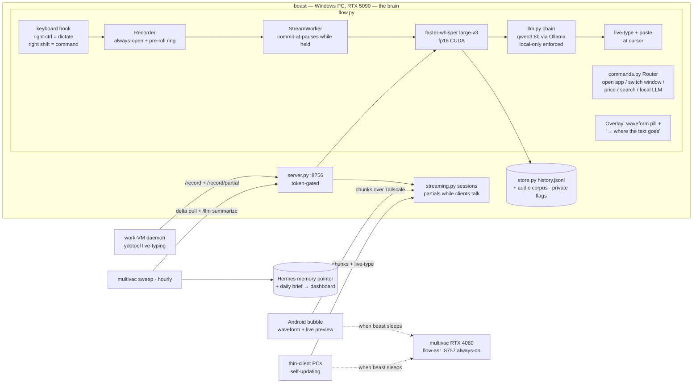
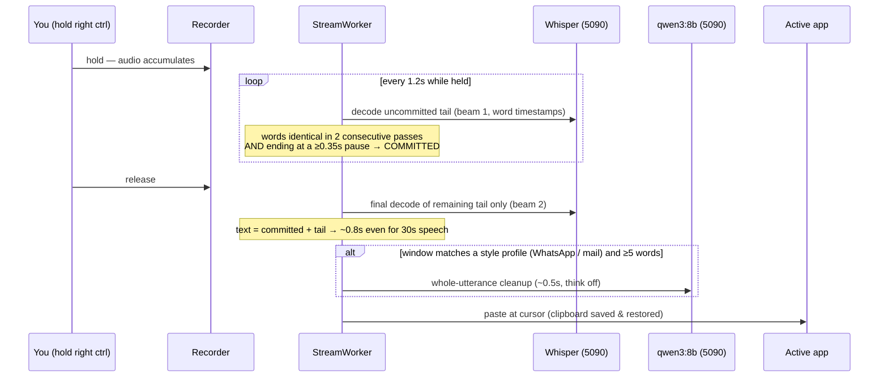

# Flow — architecture

Self-hosted voice layer across four surfaces — PC push-to-talk, Android bubble,
a Linux work-VM bridge, and thin-client PCs — all transcribed on hardware you
own. **local_only is enforced in code**: the cleanup/command LLM refuses any
non-loopback endpoint (see [Privacy](#privacy-boundaries)).

## System map



## Dictation pipeline (the latency story)



Key decisions baked into this path:

- **Commit only at pauses.** Cutting audio mid-phrase mangles formatting
  ("10%" → "10 percent"); committing at ≥0.35s gaps keeps phrases intact.
- **Word-level agreement, not segment-level.** Whisper grows one segment for a
  normal sentence, so segments never stabilize; words do.
- **VAD threshold 0.3 + `large-v3` (not turbo).** The 0.5 default silently
  deleted whispered speech before decode; turbo's 4-layer decoder is weakest
  exactly on quiet/ambiguous audio. (Research-verified, then A/B'd on real
  whisper samples.)
- **Cleanup is whole-utterance, post-release, profile-gated.** Filler-stripping
  needs the full sentence; it runs only for windows where tone matters
  (chat/email profiles), and never for <5-word snippets.

## Command mode

Right shift routes the transcript to `commands.py` instead of pasting:
regex skills first (crypto price via CoinGecko, `open <site/app>`, `search`),
otherwise the local LLM answers. Responses are spoken (SAPI) **and** shown in
the overlay pill. `POST /command` exposes the same router to remote devices.

## Live mode (`live.py`) — always-listening commands

F9 toggles a hands-free command mode (CNVS-inspired): the always-open Recorder
feeds a subscriber queue → streaming Silero VAD segments utterances (280ms
endpoint) → **Parakeet-TDT-0.6b-v3** (onnx-asr, CUDA) decodes in ~110ms →
wake-word gate ("flow …", fuzzy first-token) → the same `commands.py` router.
Measured end-of-speech→text ≈ 0.4s. Guards: PTT/remote sessions pause it
atomically (generation counter kills in-flight decodes), segmentation pauses
while SAPI speaks so it never hears itself, non-wake utterances are dropped
unstored. Whisper stays the dictation engine — Parakeet exists for command
latency only. GPU note: the pip `nvidia-*-cu12` DLLs must be preloaded by
absolute path (`ParakeetEngine._preload_gpu_dlls`) or ORT silently falls back
to CPU; `_cuda_actually_used` probes the real session provider because
`get_available_providers()` lies about that.

## LLM chain (`llm.py`)

```
local: Ollama qwen3:8b  (native /api/chat, think:false, keep_alive -1, warmed at startup)
  └─ on failure → fallback block in config (z.ai glm-4.7, anthropic-shape)
       └─ on failure → raw transcript passes through unchanged
```

The Ollama call uses the **native** API because the OpenAI-compat endpoint
drops `think:false` and Qwen3 then burns ~7s on hidden reasoning.

## Server API (`server.py`, port 8756)

| Route | Auth | Purpose |
|---|---|---|
| `GET /` | page public, data via API | dashboard (stats, activity, pipeline, recent) |
| `GET /health` | none | liveness `{ok, model}` |
| `GET /apk`, `GET /apk/version` | none (tailnet-only) | Android self-update channel |
| `POST /transcribe` | Bearer | raw audio body → `{text, asr_s, duration_s}` |
| `POST /v1/audio/transcriptions` | Bearer | OpenAI-Whisper-compatible (multipart, m4a/ogg/wav via PyAV); strict `{text}` response |
| `POST /command` | Bearer | audio → transcript → command router → `{text, response}` |
| `POST /llm` | Bearer | `{system,text}` → local model only (never fallback) — used by the multivac sweep |
| `POST /stream/start` → `/stream/<sid>/audio|finish|cancel` | Bearer | streaming sessions: each audio chunk returns the committed-so-far text; finish decodes only the tail |
| `POST /record/start|stop|cancel`, `GET /record/partial` | Bearer | VM bridge: host-mic session + live committed text for delta typing |
| `POST /brief`, `GET /api/brief` | Bearer | sweep posts the daily brief back; dashboard shows it |
| `POST /clientlog` | none (tailnet) | phone/client crash + insert diagnostics |
| `GET /client/setup.ps1`, `/client/file/*`, `/client/version` | none (tailnet) | thin-client installer + self-update channel |
| `GET /vm/setup.sh`, `/vm/daemon.py` | none (tailnet) | VM bridge installer + daemon self-update |
| `GET /api/history?limit&since` | Bearer | entries + cursor; `since` marks a delta sync |
| `GET /api/stats`, `GET /api/meta` | Bearer | totals; model/storage/uptime/last-pull/fallback-node health |

A `threading.Lock` serializes the GPU between hotkey and server calls.

## Fallback ASR node (multivac RTX 4080)

`multivac/asr_node.py` runs as systemd `flow-asr` on multivac (port 8757, same
token): always-on, one-shot `/transcribe` only — no streaming, no cleanup,
degraded on purpose. Phone and thin clients try beast first and fall back here,
so dictation survives beast sleeping. The dashboard shows its health.

## Invariant tests (`tests/`)

`python -m pytest tests -q` — pins the promises that must never regress:
local_only drops non-loopback LLM lanes; the cloud lane (when explicitly
enabled) gets a sanitized prompt with no window/app context; private entries
never archive audio (enforced inside `store.add`); the OpenAI route returns
strictly `{text}`; history requires auth. Written before the streaming rework;
caught a real defense-in-depth gap on first run.

## Data model

`data/history.jsonl` — one JSON object per dictation:
`{id, ts, text, cleaned, source, window, duration_s, asr_s, words, model, device, audio}`

- **`text` is always the raw transcript** — fillers and hesitations are signal
  about the speaker, kept deliberately. `cleaned` is what was pasted (null if same).
- `data/dataset/<date>/<id>.wav` — paired audio (archive_audio on): the full
  signal (tone, pace) and a future fine-tuning corpus of your own voice.
- Everything under `data/` is gitignored, as are `config.json` (holds the
  server token + fallback API key) and logs.

## Hermes integration (context sweep)

Hourly cron on multivac: pull only new entries (`since=<cursor>`), summarize
**on beast's GPU** via `/llm`, then write:

1. a constant-size 2-line pointer into Hermes's always-injected `MEMORY.md`
   (sentinel-delimited, replaced each run — context cost never grows; pull, not push),
2. the full day brief to `~/.hermes/imports/flow-context-<day>.md` (30-day retention),
3. a permanent copy to `~/vault/memory/`.

If beast is offline the sweep skips; the brief goes stale rather than falling
back to a cloud API.

## Android app (`android/`)

Zero-dependency Kotlin (one androidx artifact for FileProvider). Components:

- **BubbleService** — overlay bubble: hold=record (AudioRecord → WAV →
  `POST /transcribe`), drag=move, blue/red/amber states; hidden unless a
  keyboard is visible (accessibility as the IME detector).
- **FlowAccessibilityService** — inserts text at the cursor, **paste-first**
  (immune to hint-text-as-content, honors cursor position), SET_TEXT merge as
  fallback. Must be `exported="true"` or Android won't list it; sideloads need
  the one-time "Allow restricted settings" unlock.
- **Updater** — checks `/apk/version` on open, downloads and offers install.
- whisper-to-input (third-party IME) works against `/v1/audio/transcriptions`
  as an alternative keyboard-based path.

## Privacy boundaries

Leaves your hardware, ever:

1. **CoinGecko / opened sites** — the extracted query of a voice command
   ("bitcoin"), not your speech.
2. **Open-Meteo** — only the configured or spoken location string is sent for
   geocoding; its derived coordinates are then sent to the forecast feed.

That's the list. `local_only: true` (the default) makes `llm.chain` DROP any
lane whose endpoint isn't provably loopback before calling it — a cloud
fallback that sneaks into config is skipped, not sanitized. (The old z.ai
cleanup fallback is deactivated; re-enabling it requires both configuring it
AND flipping local_only off.) Unknown remote devices (e.g. a family member's
thin client) are stored `private`: no audio archive, excluded from the Hermes
sweep — enforced inside `store.add`, tested in `tests/`.

Everything else — audio, transcripts, briefs, the corpus — stays on beast and
multivac. Phone traffic rides Tailscale (WireGuard, E2E). Note: once Hermes
reads the daily brief, Hermes's own cloud model provider sees it — that's a
property of Hermes, not of Flow.

## Ops

- Autostart: `flow.vbs` in the user Startup folder; single-instance lock on
  `127.0.0.1:18756`; startup unmute-recovery (a crash mid-recording used to
  leave system speakers muted).
- Windows firewall: inbound TCP 8756 allowed ("Flow ASR server" rule).
- Latency budget (measured): hold→release ~constant regardless of length;
  release→pasted ≈ 0.7–0.9s raw path, +~0.5s styled windows.
